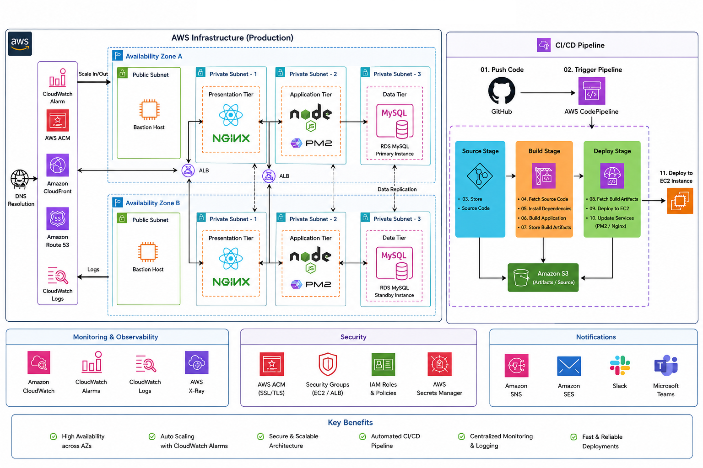
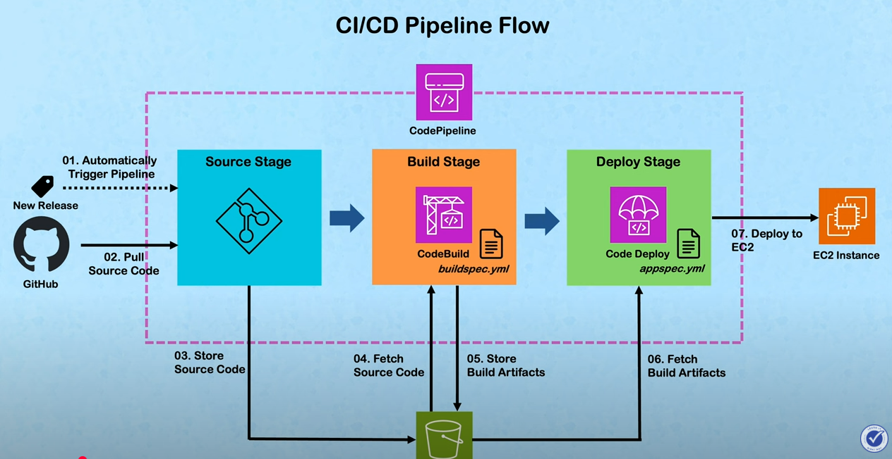
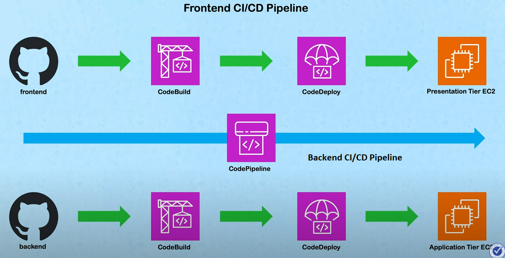
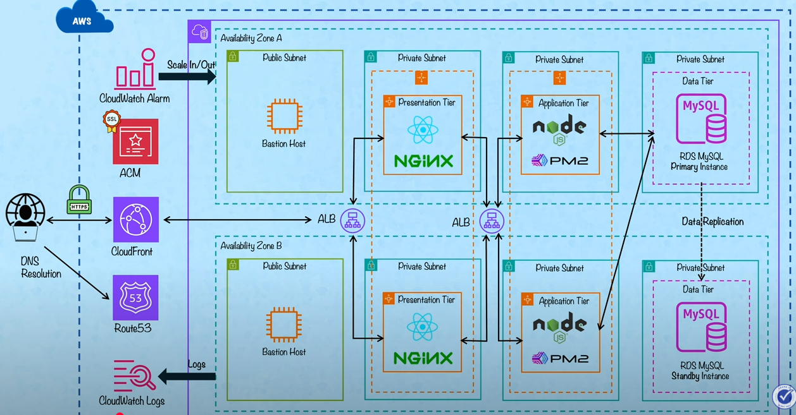

# 🚀 Highly Available 3-Tier AWS Architecture with Automated CI/CD

<p align="center">
  <strong>Building, Deploying & Automating a Scalable Full-Stack Application on AWS</strong>
</p>

<p align="center">
  
  
  
  
  
  
</p>

---

## 📌 Project Overview

This project demonstrates the implementation of a **highly available, scalable, and automated 3-Tier Web Application Architecture on Amazon Web Services (AWS)**.

The infrastructure separates the application into three independent layers:

- **Presentation Tier:** React.js frontend served through NGINX.
- **Application Tier:** Node.js and Express.js backend responsible for application logic and API processing.
- **Database Tier:** Amazon RDS MySQL for persistent data storage.

The infrastructure is designed with Multi-AZ deployment principles to improve availability and fault tolerance.

To automate application delivery, AWS CodePipeline, CodeBuild, and CodeDeploy are integrated into a CI/CD workflow, reducing manual deployment effort and providing a consistent release process.

## 🎯 Project Objectives

- Design and deploy a production-oriented 3-tier architecture.
- Implement separation between frontend, backend, and database layers.
- Deploy application components on AWS EC2.
- Configure NGINX as a web server and reverse proxy.
- Configure private connectivity between application and database tiers.
- Implement Multi-AZ architecture for high availability.
- Automate application build and deployment using AWS CI/CD services.
- Implement security using VPC networking and Security Groups.

---

## 🏗️ AWS Architecture

### Architecture Diagram



The architecture consists of the following major components:

| Layer | AWS Services / Technologies | Responsibility |
|---|---|---|
| Networking | Amazon VPC, Public & Private Subnets | Network isolation |
| Presentation | Amazon EC2, NGINX, React.js | Frontend delivery |
| Application | Amazon EC2, Node.js, Express.js | Backend processing |
| Database | Amazon RDS, MySQL | Persistent storage |
| CI/CD | CodePipeline, CodeBuild, CodeDeploy | Automated delivery |
| Access Control | Security Groups, IAM | Infrastructure security |

### Infrastructure Design

**1. Networking Layer**
- Create a custom VPC.
- Configure public and private subnets.
- Distribute resources across Availability Zones.
- Configure Internet Gateway and required routing.
- Apply Security Groups to control traffic between tiers.

**2. Presentation Tier**
- Deploy EC2 instances to host the React frontend.
- Install and configure NGINX.
- Serve the frontend application through NGINX.
- Configure NGINX reverse proxy to forward API requests to the backend.

**3. Application Tier**
- Deploy Node.js application on EC2.
- Configure Express.js API endpoints.
- Connect the application to Amazon RDS MySQL.
- Keep application communication within the private network.

**4. Database Tier**
- Use Amazon RDS MySQL for relational data storage.
- Configure database connectivity through private networking.
- Restrict database access to the application tier.
- Use Multi-AZ capabilities where configured for database availability.

---

## 🔄 Application Request Workflow

1. A user accesses the application through a web browser.
2. The request reaches the frontend EC2 instance running NGINX.
3. NGINX serves the React.js application.
4. When the user performs an operation, React sends an API request.
5. NGINX forwards the API request to the Node.js backend.
6. The backend processes the request and communicates with RDS MySQL.
7. MySQL returns the requested data to the backend.
8. The backend sends the response to the frontend.
9. React updates the user interface.

### Application Communication Flow

```text
                 USER
                   |
                   v
             NGINX WEB TIER
                   |
          +--------+--------+
          |                 |
          v                 v
      React UI         /api Requests
                            |
                            v
                    NODE.JS BACKEND
                            |
                            v
                       RDS MYSQL
                            |
                            v
                    DATABASE RESPONSE
                            |
                            v
                      REACT UI
```

---

## ⚙️ Automated CI/CD Pipeline

### CI/CD Architecture



The project integrates AWS native CI/CD services to automate application delivery.

### Pipeline Workflow

```text
       Developer
           |
           v
      Git Repository
           |
           v
    AWS CodePipeline
           |
           v
      AWS CodeBuild
           |
           v
     Build & Validate
           |
           v
     AWS CodeDeploy
           |
           v
   Target EC2 Instances
           |
           v
   Application Deployment
           |
           v
     Live Application
```

### CI/CD Components

| Service | Purpose |
|---|---|
| GitHub | Source code management |
| AWS CodePipeline | Orchestrates the deployment pipeline |
| AWS CodeBuild | Builds and validates application artifacts |
| AWS CodeDeploy | Automates deployment to target EC2 instances |

### Deployment Workflow

1. Developer pushes updated code to the Git repository.
2. CodePipeline detects the source change.
3. CodeBuild executes the configured build process.
4. Build artifacts are prepared for deployment.
5. CodeDeploy deploys the application to the configured EC2 instances.
6. The application is updated and becomes available after successful deployment.

---

## 🔐 Security Implementation

Security is an important part of the architecture.

- Use IAM roles and policies to control AWS service permissions.
- Apply Security Groups with least-privilege access.
- Restrict database access to authorized application resources.
- Keep backend and database resources in private subnets where configured.
- Avoid exposing database ports to the public internet.
- Store application credentials securely rather than hardcoding them.
- Use controlled SSH access for instance administration.

### Example Network Access Policy

| Source | Destination | Port | Purpose |
|---|---|---|---|
| Internet | Web Tier | 80/443 | HTTP/HTTPS |
| Web Tier | Application Tier | Application port | API communication |
| Application Tier | RDS MySQL | 3306 | Database connectivity |
| Administrator | EC2 | 22 | SSH administration |

*Configure actual ports and source Security Groups according to your deployment.*

---

## 📂 Repository Structure

```text
Deploying-3-Tier-AWS-Architecture-with-Automated-CI-CD/
│
├── backend/
│   └── Node.js application
│
├── frontend/
│   └── React.js application
│
├── Architecture.png
├── architecture1.png
│
├── 1.png
├── 2.png
├── 3.png
│
├── AWS CICD Pipeline - AWS.txt
│
├── app-tier-user-data.txt
├── web-tier-user-data.txt
│
└── README.md
```

---

## 🛠️ Technologies Used

### Cloud & Infrastructure
- Amazon Web Services (AWS)
- Amazon VPC
- Amazon EC2
- Amazon RDS
- Availability Zones
- Internet Gateway
- Security Groups
- IAM

### Application Development
- React.js
- Node.js
- Express.js
- MySQL
- REST APIs

### Web Server
- NGINX
- Reverse Proxy

### DevOps & Automation
- Git
- GitHub
- AWS CodePipeline
- AWS CodeBuild
- AWS CodeDeploy

### Operating System & Administration
- Linux
- Amazon Linux
- SSH
- EC2 User Data

---

## 🚀 Deployment Guide

### Prerequisites

Before deploying the project, ensure you have:

- An active AWS account.
- AWS IAM permissions for the required services.
- Git installed.
- Basic knowledge of Linux administration.
- Node.js and npm.
- Basic knowledge of VPC, EC2, RDS, and Security Groups.

### Step 1: Clone the Repository

```bash
git clone https://github.com/mukulranjan27/Deploying-3-Tier-AWS-Architecture-with-Automated-CI-CD.git

cd Deploying-3-Tier-AWS-Architecture-with-Automated-CI-CD
```

### Step 2: Configure Backend

```bash
cd backend
npm install
```

Configure the required database environment variables according to your backend configuration.

Example:

```env
DB_HOST=your-rds-endpoint
DB_USER=your-db-username
DB_PWD=your-db-password
DB_DATABASE=your-database-name
```

Never commit actual credentials or `.env` files to GitHub.

### Step 3: Configure Frontend

```bash
cd frontend
npm install
npm run build
```

### Step 4: Configure AWS Infrastructure

1. Create the VPC and required subnets.
2. Configure routing and Internet Gateway.
3. Launch the EC2 instances.
4. Configure Security Groups.
5. Configure Amazon RDS MySQL.
6. Deploy the backend application.
7. Deploy the frontend and configure NGINX.

### Step 5: Configure CI/CD

1. Connect the GitHub source repository.
2. Create an AWS CodePipeline pipeline.
3. Configure the CodeBuild build specification.
4. Configure CodeDeploy deployment resources.
5. Connect the deployment stage to the target EC2 instances.
6. Push a code change and verify the pipeline execution.

Refer to the repository's deployment scripts and CI/CD notes for implementation details.

---

## 📸 Project Screenshots


### Application Interface







---

## 💡 Key Learning Outcomes

Through this project, I gained practical experience in:

- Designing AWS 3-tier architecture.
- Implementing VPC networking and subnet isolation.
- Deploying frontend and backend applications on EC2.
- Configuring NGINX reverse proxy.
- Integrating Node.js with Amazon RDS MySQL.
- Understanding Multi-AZ high-availability design.
- Implementing automated CI/CD using AWS native services.
- Managing infrastructure access using IAM and Security Groups.
- Troubleshooting application connectivity and deployment issues.
- Understanding production-oriented cloud deployment workflows.

---

## 🔮 Future Improvements

Potential improvements to make the architecture more production-ready:

- Introduce an Application Load Balancer.
- Implement Auto Scaling Groups.
- Enable HTTPS using AWS Certificate Manager.
- Add CloudWatch monitoring, metrics, and alarms.
- Implement AWS Secrets Manager for credential management.
- Introduce infrastructure provisioning using Terraform.
- Implement blue/green deployment strategies.
- Add centralized logging and application monitoring.
- Implement automated testing and security scanning.

---

## 👨‍💻 Author

**Mukul Ranjan**

Cloud & DevOps Enthusiast | AWS | Linux | Docker | Kubernetes | Terraform | Jenkins | Ansible

Interested in building scalable cloud infrastructure, automation, DevOps engineering, and reliable deployment solutions.

- GitHub: [@mukulranjan27](https://github.com/mukulranjan27)
- Project Repository: [3-Tier AWS Architecture with Automated CI/CD](https://github.com/mukulranjan27/Deploying-3-Tier-AWS-Architecture-with-Automated-CI-CD)

---

## ⭐ Support

If you find this project useful for learning AWS, Cloud Architecture, or DevOps practices, consider giving this repository a star!

**Built to learn, automate, and engineer scalable cloud infrastructure.**
